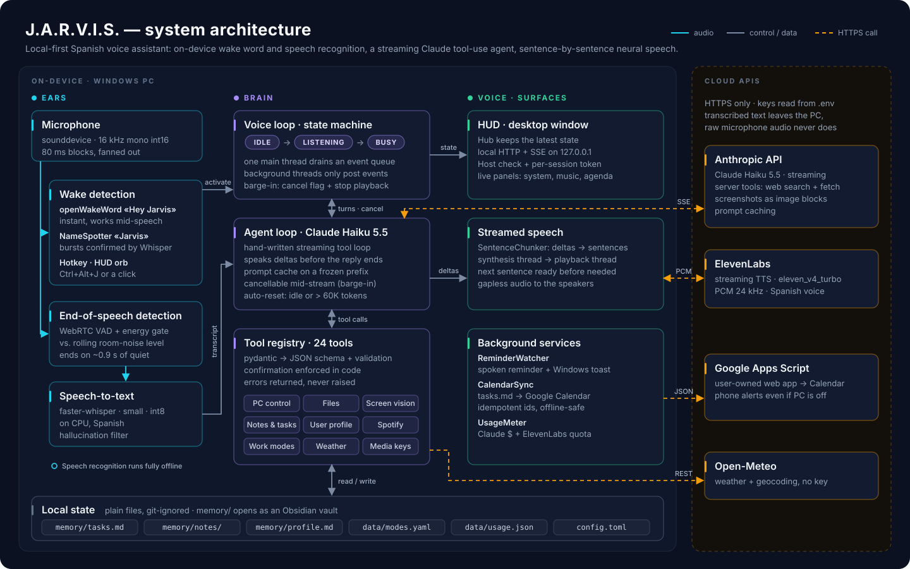
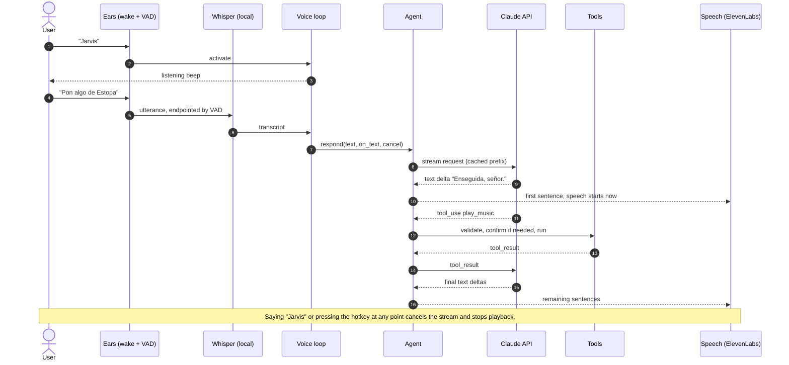

<div align="center">

# J.A.R.V.I.S.

**A local-first voice assistant for Windows that understands and speaks Spanish, built around a streaming Claude tool-use agent.**

Say *«Jarvis»*, ask for something in plain Spanish, and it answers out loud one sentence at a time while it works on your PC: apps, files, the screen, music, notes, reminders, your calendar and the web.

[](https://www.python.org/)
[](https://docs.anthropic.com/)
[](https://github.com/SYSTRAN/faster-whisper)
[](https://elevenlabs.io/)
[](#testing-and-evaluation)
[](https://github.com/astral-sh/ruff)

**English** · [Español](README.es.md)

</div>

---

## Highlights

- **End-to-end voice agent.** An on-device wake word, speech detection and Whisper transcription feed a hand-written Claude tool-use loop. The reply is streamed to ElevenLabs as speech.
- **Speaks while it thinks.** Text deltas are split into sentences as they arrive, and one thread synthesizes while another plays. Jarvis starts talking at the first full sentence, before the model has finished, and you can interrupt it at any moment.
- **24 tools with guardrails in code.** Inputs are validated with pydantic, risky actions require a spoken "yes" that the registry enforces (not the model), file access stays inside a sandbox, and there is no delete tool and no shell tool.
- **Engineered for cost.** The prompt prefix never changes, so the cache keeps hitting. Conversations reset automatically on idle or when the context grows past a limit, three verbosity levels trade detail for cost, and a usage meter tracks the spend live.
- **Private by design.** Wake word and speech recognition run on the CPU. Raw microphone audio never leaves the PC, and memory is plain Markdown on disk.
- **Tested.** 260 pytest tests cover the agent loop, the voice state machine, endpointing under noise, the tools, calendar sync and the HUD server. A self-test exercises the real audio path without a human at the mic.

## What you can ask

The assistant speaks Castilian Spanish; the code, comments and tests are in English.

| You say | What happens |
|---|---|
| «Abre Chrome y sube el volumen al cuarenta» | Launches the app and sets the system volume |
| «¿Por qué va lento el ordenador?» | Reads CPU, memory and the heaviest processes, then explains |
| «Busca el PDF de la factura de la luz y muévelo a Impuestos» | Searches your folders, reads the PDF, asks before moving it |
| «¿Qué significa este error?» | Captures the active monitor and has Claude read the screenshot |
| «Recuérdame mañana a las diez revisar el presupuesto» | Creates a task, announces it on time, and mirrors it to Google Calendar so your phone notifies too |
| «Pon algo de Estopa» / «¿Qué está sonando?» | Drives the Spotify desktop app with your existing session |
| «Vamos a crear un modo trabajo» | Defines a named routine by conversation (open/close apps, URLs, volume, music, a phrase) |
| «Busca gráficas por unos 400 € y déjame una tabla en el escritorio» | Web search and fetch, then writes the result to a file |

On the first start of each day it gives a short spoken briefing with the weather and your tasks.

## Architecture

<p align="center">
  
</p>

| Layer | Responsibility | Key modules |
|---|---|---|
| **Ears** | One microphone stream fanned out to three consumers: two wake detectors and the utterance recorder. Speech ends on ~0.9 s of near-silence, then faster-whisper transcribes on the CPU. | [`audio/mic.py`](jarvis/audio/mic.py), [`audio/wake.py`](jarvis/audio/wake.py), [`audio/recorder.py`](jarvis/audio/recorder.py), [`audio/stt.py`](jarvis/audio/stt.py) |
| **Voice loop** | A state machine (`IDLE → LISTENING → BUSY`) on a single thread that drains an event queue. Background threads only post events, and an interruption sets a cancel flag and silences the speaker. | [`app.py`](jarvis/app.py) |
| **Agent** | Streaming Claude conversation with client tools (local functions) and server tools (web search and fetch run by Anthropic). | [`brain/agent.py`](jarvis/brain/agent.py), [`brain/prompt.py`](jarvis/brain/prompt.py) |
| **Tools** | A decorator-based registry that turns pydantic models into JSON schemas, validates inputs, enforces confirmations and converts every failure into a tool result. | [`brain/tools/`](jarvis/brain/tools) |
| **Speech** | `SentenceChunker` turns deltas into sentences, then a two-thread pipeline (synthesis → playback) streams 24 kHz PCM from ElevenLabs. | [`text.py`](jarvis/text.py), [`audio/tts.py`](jarvis/audio/tts.py) |
| **HUD** | Edge in app mode shows a local page fed by Server-Sent Events: state orb, transcript, tool activity, system meters, now playing, today's agenda and usage. | [`ui/`](jarvis/ui) |
| **Background** | Reminders, the Google Calendar sync and usage accounting run off the main thread. | [`reminders.py`](jarvis/reminders.py), [`calendar_sync.py`](jarvis/calendar_sync.py), [`usage.py`](jarvis/usage.py) |

### One voice turn, step by step



## Engineering decisions

**A hand-written agent loop instead of the SDK tool runner.** The voice pipeline needs three things at once: text deltas as they stream, so speech starts early; image blocks inside tool results, for screenshots; and cancellation mid-stream when the user barges in. The loop also handles the cases that break naive agents. A truncated `tool_use` at `max_tokens` is never executed, `pause_turn` from server tools is resumed, unparsable streamed tool JSON is retried, a refusal resets the conversation, and if the organization has web search disabled the turn is retried without the server tools. → [`brain/agent.py`](jarvis/brain/agent.py)

**Treating prompt caching as a design rule.** The system prompt is built once per conversation and then frozen. The tool list is sorted so it is identical byte for byte between runs. Anything that changes every turn (the spoken timestamp, the verbosity level, an "you were interrupted" note) goes into the user turn instead of the system prompt. The history is append-only because Claude's thinking blocks stay valid only while everything before them is unchanged. To keep cost and latency bounded, the conversation restarts after 10 idle minutes or past 60K context tokens.

**Two-stage wake word.** openWakeWord's `hey_jarvis` model is instant and works while Jarvis is speaking, but it was trained on English voices: a Spanish speaker saying just *«Jarvis»* scored under 0.05. Whisper recognizes the name reliably, but it takes about a second per call, too slow to run on every audio block. The `NameSpotter` only sends Whisper the one acoustic shape a name has when someone calls out: a short burst of speech with silence before and after. → [`audio/wake.py`](jarvis/audio/wake.py)

**Endpointing that survives real rooms.** WebRTC VAD alone flags fan noise, keyboard clicks and a distant TV as voice, and each false frame would delay the end of the recording. A frame only counts as speech if the VAD agrees *and* it is loud relative to a rolling estimate of the room's noise level. The end of speech is "almost no speech in the last 0.9 s", not "0.9 s without a single speech frame". The room level is measured before the listening beep, because users often say "Jarvis, abre Chrome" in one breath and there is no silence to measure. [`scripts/eval_endpointing.py`](scripts/eval_endpointing.py) sweeps silence, white noise and background speech at several levels; the tests do the same. → [`audio/recorder.py`](jarvis/audio/recorder.py)

**Safety enforced in code, not in the prompt.** Closing apps, moving or renaming files, overwriting a file and deleting a mode all require a spoken confirmation. The tool registry asks for it before the tool runs, and anything other than a clear "yes" counts as a no. File tools resolve every path and refuse anything outside the allowed folders or under `AppData`, `.ssh`, `.aws`, `.env` and similar. Closing an app asks its windows to close and never forces past a "save changes?" dialog. → [`brain/tools/registry.py`](jarvis/brain/tools/registry.py), [`brain/tools/files.py`](jarvis/brain/tools/files.py)

**A localhost UI that other websites can't use to send commands.** Binding to `127.0.0.1` is not enough, because any page open in the browser can send requests to localhost, and this server's commands end up controlling the PC. Every request must carry the right `Host` header (which blocks DNS rebinding), and the event stream and the actions require a random token that only the HUD window receives. → [`ui/server.py`](jarvis/ui/server.py)

**Calendar sync as reconciliation, not an operation log.** `memory/tasks.md` is the source of truth, and it can be edited by a tool or by hand in Obsidian. Each pass compares it with what was already sent and asks a small Apps Script web app, in the user's own Google account, to create or delete only the difference. Event IDs are derived from the task's text and date, so retries and lost state can never create duplicates, and it catches up by itself after being offline. No Google Cloud project, no OAuth app, nothing that expires. → [`calendar_sync.py`](jarvis/calendar_sync.py), [`calendar_script.gs`](jarvis/calendar_script.gs)

**Failure is part of the conversation.** Tools never raise: validation errors, expected failures and bugs all come back to the model as `is_error` tool results, so it can recover or explain. API failures (bad key, rate limit, outage, no internet) are spoken in character instead of crashing the voice loop.

**Cost you can see.** ElevenLabs reports characters used and the plan limit, so those are read from the account. Anthropic does not expose spend to a regular API key, so token usage is counted from every response and priced locally. Measured against `normal`, the `breve` verbosity level costs about half and `detallado` about three times as much. → [`usage.py`](jarvis/usage.py), [`brain/verbosity.py`](jarvis/brain/verbosity.py)

## Tech stack

| Concern | Choice |
|---|---|
| Language model | Claude Haiku 5.5 via the Anthropic Messages API (streaming, tool use, prompt caching, server-side web search and fetch) |
| Speech-to-text | faster-whisper `small`, int8 on CPU, one thread per physical core (measured ~30% faster than the default on an 8-core CPU) |
| Wake word / VAD | openWakeWord, Whisper-confirmed name spotting, WebRTC VAD |
| Text-to-speech | ElevenLabs streaming (`eleven_v4_turbo`, PCM 24 kHz) |
| Audio I/O | sounddevice, NumPy, SciPy |
| Windows integration | pycaw (volume), psutil, mss (screen), pynput (hotkey), WinRT media session, winotify (toasts) |
| UI | Standard-library HTTP server + Server-Sent Events, Edge/Chrome in app mode |
| Validation & config | pydantic v2, TOML, python-dotenv |
| Tooling | uv, pytest, Ruff |

## Tools

| Area | Tools |
|---|---|
| PC control | `open_app`, `close_app`, `open_url`, `set_volume`, `media_control`, `system_status` |
| Files (sandboxed) | `search_files`, `read_file` (text and PDF), `move_or_rename`, `write_file` |
| Vision | `look_at_screen`: captures the monitor holding the active window |
| Memory | `save_note`, `search_notes`, `remember_fact`, `create_task`, `list_tasks`, `complete_task` |
| Music | `play_music`, `music_now_playing` via the Spotify desktop app's bundled CLI, with no API keys |
| Routines | `save_mode`, `run_mode`, `list_modes`, `delete_mode` |
| Info | `get_weather` (Open-Meteo), plus Anthropic's server-side web search and web fetch |

## Getting started

**Requirements:** Windows 11, [uv](https://docs.astral.sh/uv/), a microphone, an [Anthropic API key](https://console.anthropic.com/settings/keys) and an [ElevenLabs API key](https://elevenlabs.io/app/settings/api-keys). Spotify control needs the Microsoft Store version of Spotify.

```powershell
git clone https://github.com/jlopezd-DataScienceandAI/jarvis.git
cd jarvis
uv sync                                 # installs Python 3.11 and dependencies
copy .env.example .env                  # then paste your API keys into .env

uv run jarvis selftest --offline        # checks wake word + Whisper with Windows voices; no keys needed
uv run jarvis selftest                  # microphone, Claude, ElevenLabs, wake word and Whisper
uv run jarvis                           # start the assistant with its HUD
```

Settings such as your city, the voice, the Whisper model size and the wake threshold live in [`config.toml`](config.toml). The full user manual, in Spanish, is in [README.es.md](README.es.md).

| Command | Description |
|---|---|
| `jarvis` | Voice assistant with the HUD (`--no-ui` for voice and console only) |
| `jarvis text` | Keyboard conversation with the same brain and tools; only needs the Anthropic key |
| `jarvis briefing` | Start with the daily briefing |
| `jarvis selftest [--offline \| --listen \| --wake]` | Automated and interactive checks of the audio path |
| `jarvis voices [--library \| --try ID]` | Browse ElevenLabs voices, Spanish first |
| `jarvis calendar setup \| sync` | Connect Google Calendar step by step, or force a sync |

Add `-v` (`jarvis -v text`) to log tool calls and token usage.

## Testing and evaluation

```powershell
uv run pytest            # 260 tests; Claude, ElevenLabs and Google are faked
uv run ruff check .
uv run python scripts/eval_endpointing.py   # end-of-speech detection across noise backgrounds
```

The Anthropic client is replaced with scripted streams, so the agent tests replay exact event sequences: tool round trips, interrupted streams, truncated tool calls, `pause_turn`, rejected server tools, API errors. The voice-loop tests drive the real state machine with scripted utterances, a fake agent and a fake speaker, and the recorder tests mix synthesized speech with silence, white noise and background voices at several levels.

## Project structure

```text
jarvis/
├── app.py               # voice loop: activation → listen → think → speak
├── __main__.py          # CLI
├── audio/               # mic fan-out, wake word, endpointing, Whisper, ElevenLabs pipeline
├── brain/
│   ├── agent.py         # streaming Claude tool-use loop
│   ├── prompt.py        # frozen system prompt
│   ├── verbosity.py     # breve / normal / detallado
│   └── tools/           # registry + PC, files, screen, memory, music, modes, web
├── ui/                  # HUD: state hub, local SSE server, app window, monitors
├── memory_store.py      # Markdown notes, tasks and profile
├── calendar_sync.py     # tasks.md → Google Calendar reconciliation
├── reminders.py · briefing.py · weather.py · usage.py · selftest.py
tests/                   # 260 tests
scripts/                 # endpointing evaluation, autostart installer
docs/architecture.svg
```

## Privacy

- Wake word detection and transcription run locally. Raw audio is never uploaded.
- Transcribed text, files Jarvis reads and screenshots go to the Anthropic API. The text Jarvis speaks goes to ElevenLabs.
- Notes, tasks, the user profile, modes and usage live in `memory/` and `data/` as plain files. Those folders and `.env` are git-ignored.
- If you connect Google Calendar, the text and time of dated tasks are sent to a script in your own Google account.

## Roadmap

- Home automation through Home Assistant
- Email, and reading events back from the calendar
- An offline fallback voice when ElevenLabs is unreachable
- Muting Windows notifications on demand
